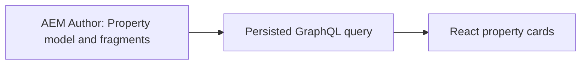

# Property Finder — React + AEM Headless

A property listing application that reads structured content from Adobe Experience Manager using a persisted GraphQL query and renders it in React.

## What this project demonstrates

- A Property Content Fragment Model with typed price, bedroom, bathroom and featured fields.
- Author-managed property listings, including a featured three-bedroom Bristol house.
- A persisted GraphQL query that delivers the fields required by the React cards.
- Credentialed local Author access with an explicit CORS policy.
- Loading, empty, network, authentication and GraphQL error states in React.
- A repeatable local content setup script that keeps existing fragments.

## Architecture



| Folder | Purpose |
| --- | --- |
| [property-finder-react](property-finder-react) | React 19 and Vite frontend, content setup script and GraphQL query |
| [property-finder-aem](property-finder-aem) | AEM Maven project, OSGi configuration, content packages and Dispatcher configuration |

The application-specific headless work is in the React application, its `aem/` setup files and the AEM Author CORS configuration. The AEM project also retains its generated archetype modules and example tests.

## Property data

| Field | Type |
| --- | --- |
| title | Text |
| price | Number, GBP |
| location | Text |
| bedrooms / bathrooms | Integers |
| propertyType | Text |
| description | Multiline text, queried as `description.plaintext` |
| featured | Boolean |

The initial content contains three clearly labelled sample listings and the Bristol listing. Existing samples do not invent values for optional fields.

## Run locally

Requirements: Node.js 22.12+ (Node 24 used during development), npm, Java 21, Maven 3 and an AEM SDK obtained separately from Adobe. AEM binaries and repository data are not included.

1. Start AEM Author at `http://localhost:4502`.
2. Build and deploy the AEM project:

```sh
cd property-finder-aem
mvn clean install -PautoInstallSinglePackage
```

3. Install the React dependencies and create local content:

```sh
cd ../property-finder-react
npm ci
node aem/setup-local.mjs --apply --update-details
npm run dev
```

4. Sign in to AEM in the same browser, then open `http://localhost:5173`.

The development configuration uses AEM's standard local-only credentials. Override them for your own instance using Maven properties and `AEM_USERNAME` / `AEM_PASSWORD` for the setup script. Do not use local development credentials in a deployed environment.

The persisted query is:

```text
/graphql/execute.json/propertyfinder/properties-list
```

See the [React setup guide](property-finder-react/README.md) for troubleshooting and authoring links.

## Validation

```sh
cd property-finder-react
npm run lint
npm run build
node aem/setup-local.mjs --apply
```

React lint and production build passed locally. The content setup verified four listings, the supplied Bristol field values and data types, and credentialed CORS. The AEM Maven test suite has not been rerun as part of preparing this GitHub repository.

## Current scope

This repository provides the source and local setup. It does not include a publicly hosted demo; the React frontend needs a reachable AEM instance. Search, filtering, property images and production authentication are not implemented.

## Attribution

The AEM project is based on Adobe's AEM Project Archetype and retains its [Apache 2.0 license](property-finder-aem/LICENSE). The content model follows the Adobe WKND reference structure linked in the React documentation.
